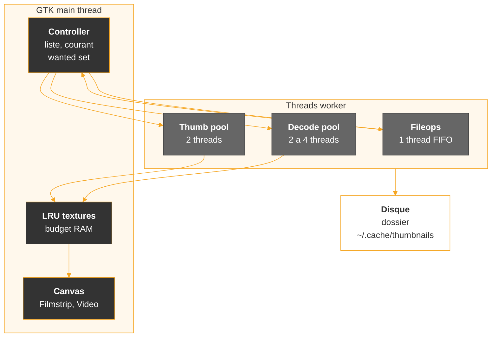

# picme - plan d'architecture

## 1. Décision

Workspace Cargo à deux crates : `picme-core` (aucune dépendance GTK : decode, orientation, thumbnails freedesktop, LRU, pool, édition de fichiers ; testable headless) et `picme` (binaire GTK4 : fenêtre, canvas, filmstrip, vidéo, DnD, raccourcis).

Principe central : la navigation ne bloque jamais sur un decode. À chaque changement d'image, le main thread affiche tout de suite le meilleur état disponible (texture fit en cache, sinon thumbnail étirée), puis remplace quand le worker livre. Trois niveaux par image : `Preview` (thumbnail freedesktop, ou JPEG décodé à 1/8-1/4 par DCT scaling, ou thumbnail embarquée HEIF), `Fit` (taille de la fenêtre en device pixels), `Full` (uniquement au zoom, un seul slot).

Le cache mémoire ne garde que des textures `Fit` (8 Mo en 1080p, 33 Mo en 4K), pas des pleines résolutions (96 Mo pour 24 MP) : c'est ce qui rend le budget RAM tenable. Budget par défaut 256 Mo (`--cache-mb`), LRU, l'image courante n'est jamais évincée ; un seul slot `Full`, libéré dès qu'on quitte l'image ; thumbnails du filmstrip réduites à 96 px de haut, LRU de 400 (environ 22 Mo).

JPEG par `turbojpeg` (libjpeg-turbo système via pkg-config) : une seule lib donne le DCT scaling (n/8) et `tjTransform` (rotation et crop sans perte). HEIC et AVIF par `libheif-rs` (un seul chemin pour les deux). PNG, WebP, TIFF par `image`. JXL par `jxl-oxide`. Sortie unique : RGBA8, orientation déjà appliquée.

Toute opération qui modifie le disque (rotation, crop, trash, delete) passe par un seul thread `fileops` en FIFO : l'ordre des touches est l'ordre des écritures, aucune course entre R, C et Suppr sur le même fichier.

Défaut d'édition proposé : rotation = écrasement atomique en place (sans perte et réversible) ; crop = copie `<stem>-crop.<ext>` à côté (Entrée), remplacement seulement sur Shift+Entrée et l'original part alors à la corbeille.

Écartés : zune-jpeg (ni DCT scaling exploitable ni transform sans perte, il faudrait turbojpeg en plus) ; thumbnail EXIF comme premier affichage (160x120 trop flou, et périmée après un `tjTransform`) ; rayon (ni priorités ni annulation de la file) ; `GApplication` (aller-retour D-Bus au démarrage, inutile sans instance unique) ; cache partagé entre threads (le LRU vit sur le main thread, seule la file du pool est partagée) ; `avif-native` de `image` (dav1d en plus, libheif le fait déjà) ; plugin `gst-plugin-gtk4` du système (version liée à gtk4-rs, on l'enregistre en statique).

## 2. Étapes d'implémentation

### Bloc 1 [worker] - toolchain et squelette

1. [worker] `docker/Dockerfile` : `FROM rust:1-trixie` (Debian 13 : glibc et libs plus anciennes que Manjaro, donc le binaire tourne sur le poste). Paquets build : `pkg-config libgtk-4-dev libgstreamer1.0-dev libgstreamer-plugins-base1.0-dev libheif-dev libturbojpeg0-dev`. Paquets runtime et fixtures : `libheif-plugin-libde265 libheif-plugin-dav1d libheif-plugin-x265 libheif-plugin-aomenc libheif-examples libjxl-tools gstreamer1.0-plugins-good gstreamer1.0-plugins-bad gstreamer1.0-libav gstreamer1.0-gl libgl1-mesa-dri`. `ENV CARGO_HOME=/cargo` avec `/cargo` en mode 1777.
2. [worker] `compose.yaml`, deux services sur la même image, tous deux `command: sleep infinity`, `user: "1000:1000"`, `working_dir: /work`, volumes `.:/work` et `cargo:/cargo`, `build.network: host` (pas de veth au build). Service `dev` : `network_mode: none`, `ipc: host`, `/tmp/.X11-unix:/tmp/.X11-unix:ro`, `DISPLAY`, `GSK_RENDERER=cairo`, `XDG_CACHE_HOME=/tmp/cache`. Service `fetch` : `network_mode: host`, sert uniquement à `cargo fetch`. Usage : `docker compose exec -T fetch cargo fetch` puis `docker compose exec -T dev cargo build --release --offline`.
3. [worker] Workspace : `Cargo.toml` racine, `crates/picme-core`, `crates/picme`. Profil release : `opt-level=3`, `lto="thin"`, `codegen-units=1`, `strip=true`, panic en unwind (pas `abort`). Profil dev : `[profile.dev.package."*"] opt-level=3`. Prendre la dernière `gst-plugin-gtk4` et aligner `gtk4` et `gstreamer` sur ses dépendances ; `cargo tree -d` ne doit montrer aucun doublon de `glib`, `gtk4`, `gstreamer`. Features gtk4 : `v4_12` au minimum, jamais au-dessus de la version du conteneur (`pkg-config --modversion gtk4`). Même règle pour la feature de version de `libheif-rs`.
4. [worker] `crates/picme/src/main.rs` minimal : `GDK_BACKEND=x11` posé avant init, `gtk::init()` + `gtk::Window` + `glib::MainLoop` (pas de `gtk::Application`), `set_decorated(false)`, fond noir par CSS, affiche `argv[1]` (JPEG) dans un `gtk::Picture`. Variable `PICME_TRACE=1` : horodatages stderr (process start, decode fini, premier frame).
5. [worker] `tests/fixtures/make.sh` exécuté dans `dev` : génère JPEG (un 4:2:0 multiple de 16, un 333x217, un avec Orientation=6), PNG, TIFF, WebP, HEIC et AVIF (`heif-enc`), JXL (`cjxl`), MOV court (`gst-launch-1.0 videotestsrc num-buffers=60 ! avenc_mpeg4 ! qtmux`). Vérif bloc 1 : build release offline OK, `picme tests/fixtures/a.jpg` affiche une fenêtre sans décoration depuis `dev`.

### Bloc 2 [worker] - picme-core sans concurrence

6. [worker] `media.rs` : `MediaKind {Jpeg, Png, Webp, Tiff, Heif, Jxl, Raw, Video}`, détection par magic bytes avec repli sur l'extension. `dir.rs` : listing d'un dossier filtré par extension, tri naturel insensible à la casse, pairing Live Photo (même stem, image + `.mov` : une seule entrée `Entry {path, kind, live_mov: Option<PathBuf>, mtime_ns, size}` ; un `.mov` seul reste une vidéo).
7. [worker] `orient.rs` : `Orientation` (les 8 valeurs EXIF), `compose(a, b)`, `inverse()`, `apply_rgba(buf, w, h)`, `map_rect` (rectangle affiché -> rectangle stocké). Test exhaustif 8x8 de `compose` contre l'application successive sur une image 3x2.
8. [worker] `decode/` : `fn decode(path, target: Target) -> Result<Frame>` avec `Target {Preview, Fit(w, h), Full}` et `Frame {rgba: Vec<u8>, w, h, full_w, full_h}`. JPEG : plus petit facteur n/8 tel que l'image couvre la cible, orientation lue par `kamadak-exif`. HEIF/AVIF : `Preview` = thumbnail embarquée si présente, sortie 8 bits RGBA, orientation laissée à libheif. Autres : decode complet puis réduction par `fast_image_resize` à la cible. Plafond : si `full_w*full_h*4` dépasse la moitié du budget, `Full` est réduit. Chaque decode est enveloppé par `catch_unwind` côté appelant.
9. [worker] `thumbs.rs` : spec freedesktop. Chemin `$XDG_CACHE_HOME/thumbnails/{large,normal}/<md5(uri)>.png` ; `uri` = `file://` + chemin absolu percent-encodé avec le même jeu de caractères que `g_file_get_uri`. Lecture : `large` puis `normal`, valide seulement si `Thumb::MTime` égale le mtime du fichier (lecture des chunks tEXt par la crate `png`). Écriture : `large` (256 px), chunks `Thumb::URI` et `Thumb::MTime`, fichier temporaire dans le même dossier puis `rename`, dossiers 0700, fichier 0600. Vidéos : lecture seule du cache.
10. [worker] `cache.rs` : `LruBytes<K, V>` mono-thread (`insert(k, v, bytes)`, `get`, `pin(k)`, éviction jusqu'à passer sous le budget, jamais l'entrée pinned). Vérif bloc 2 : `cargo test -p picme-core` vert ; decode de chaque fixture aux trois `Target` avec dimensions attendues ; un test dans `crates/picme` compare `thumbs::uri(p)` à `gio::File::for_path(p).uri()` sur des noms avec espace, accent, `#`, `%`, `?`, `+`, `[`.

### Bloc 3 [lead] - pool, controller, premier affichage

11. [lead] `pool.rs` (core) : pool de threads à file prioritaire (`Mutex` + `Condvar`), jobs `{key, target, priority}`, `submit`, `retain(|key| ...)` pour retirer les jobs devenus inutiles, déduplication par clé, résultats envoyés par `async_channel`. Deux instances : `decode` (`clamp(cores/2, 2, 4)` threads) et `thumbs` (2 threads). `Key = (path, mtime_ns, size, target)`.
12. [lead] `app.rs` (`Controller`, main thread uniquement) : liste des `Entry`, courant identifié par chemin (jamais par index), `go(delta)`, `open(path)`, `reconcile(path)` (re-stat idempotent : disparu -> retiré, mtime ou size changés -> invalidation et rechargement, nouveau -> inséré à sa place triée). À chaque changement : calcul du wanted set (courant `Preview` puis `Fit`, voisins `Fit` +1, -1, +2 dans le sens de déplacement), `pool.retain` sur ce set, affichage immédiat du meilleur état en cache. À la réception d'un résultat : `glib::Bytes::from_owned` -> `gdk::MemoryTexture` -> LRU ; affiché seulement si la clé est encore celle du courant et d'un niveau supérieur à celui affiché.
13. [lead] Démarrage : le decode `Preview` de `argv[1]` est lancé sur un thread avant `gtk::init()` ; le scan du dossier part sur un autre thread ; la fenêtre s'affiche sans attendre le scan ; le `Fit` est demandé dès que la taille réelle de la fenêtre est connue, et redemandé (debounce 150 ms) si un resize rend la texture plus petite que la fenêtre. Vérif bloc 3 : test de stress du pool (10 000 submit/retain concurrents, aucun job perdu ni dupliqué, arrêt propre) ; `PICME_TRACE` montre le `Preview` prêt avant le premier frame sur un JPEG 24 MP ; touche Droite maintenue sur 500 fixtures sans gel ni croissance de RSS au-delà du budget.

### Bloc 4 [worker] - interface

14. [worker] `canvas.rs` : sous-classe `gtk::Widget`, `snapshot()` avec `append_scaled_texture` (fit par défaut, zoom, pan), rotation visuelle par quarts de tour. Zoom par Ctrl+molette et double-clic (fit <-> 100 %) ; passer au-dessus du fit demande `Full` au controller. Molette seule = précédent/suivant.
15. [worker] `filmstrip.rs` : `gtk::ListView` horizontale virtualisée (`gio::ListStore` + `SignalListItemFactory`), bind -> demande au pool `thumbs`, unbind -> abandon ; `scroll_to` sur le courant à chaque navigation ; molette verticale convertie en défilement horizontal ; clic = `open`. Placée dans un `gtk::Revealer` au-dessus du canvas (`gtk::Overlay`) : visible 1,5 s après une navigation ou quand la souris approche du bas, cachée sinon. Curseur masqué après 2 s d'inactivité.
16. [worker] `keys.rs` : Gauche/Droite, Home/End, F = fullscreen, Q et Échap = quitter (Échap annule d'abord le crop). `osd.rs` : un label discret en overlay pour les erreurs et messages, effacé après 2 s. `gio::FileMonitor` sur le dossier -> `Controller::reconcile` (debounce 150 ms, fichiers cachés ignorés). Vérif bloc 4 : navigation clavier et molette, filmstrip qui suit, un fichier ajouté ou supprimé par un autre programme apparaît ou disparaît sans relancer.

### Bloc 5 [lead] - opérations sur les fichiers

17. [lead] `edit/atomic.rs` (core) : écriture dans `.picme-<pid>-<nom>.tmp` du même dossier, `fsync`, recopie des permissions, contrôle du résultat (relecture de l'en-tête, dimensions attendues) puis `rename` ; en cas d'échec le temporaire est supprimé et l'original intact.
18. [lead] `edit/rotate.rs` : JPEG -> `tjTransform` avec l'option PERFECT et conservation de tous les markers, opération = rotation demandée composée avec l'Orientation existante, puis tag Orientation remis à 1 par patch en place dans le buffer de sortie. Si PERFECT échoue (dimensions non multiples du MCU) -> pixels intacts, tag Orientation = composition (patch en place si le tag existe, insertion par `little_exif` sinon, à valider par test aller-retour ; en cas d'échec : vue seule). PNG -> ré-encodage (sans perte). Autres formats -> rotation de vue seule, mémorisée pour la session, OSD « rotation non enregistrée ». Jamais l'option TRIM.
19. [lead] `edit/crop.rs` : rectangle reçu en fractions de l'image affichée, converti par `map_rect`. JPEG -> crop `tjTransform`, origine alignée vers le bas sur le MCU. PNG et TIFF -> même format. Tout le reste -> JPEG qualité 92, copie uniquement. Nom `<stem>-crop.<ext>`, suffixe `-2`, `-3` si déjà pris.
20. [lead] `fileops.rs` (crate picme) : thread unique FIFO, `Op {Rotate, Crop, Trash, Delete}`, résultat renvoyé au main thread qui appelle `reconcile`. R et Shift+R : rotation visuelle immédiate puis `Op::Rotate`. Suppr -> `gio::File::trash` ; Shift+Suppr -> `gio::File::delete` sans confirmation ; les deux agissent aussi sur le `.mov` d'une Live Photo ; l'entrée est retirée tout de suite et la suivante affichée. Échec de trash (filesystem sans corbeille) -> OSD, jamais de repli sur la suppression définitive. Garde anti-répétition : une touche Suppr maintenue n'agit qu'une fois (drapeau posé à key-pressed, levé à key-released). Vérif bloc 5 : tests core sur fixtures (4 rotations = fichier décodé identique à l'original ; cas 333x217 -> tag ; Orientation=6 + R -> affichage correct et tag à 1 ; crop JPEG sans perte comparé pixel à pixel ; coupure simulée avant `rename` -> original intact) ; à la main : R trois fois très vite puis Suppr -> fichier dans la corbeille, correctement orienté.

### Bloc 6 [worker] - crop UI, DnD, vidéo, livraison

21. [worker] Crop : C entre en mode crop sur le canvas (rectangle à poignées, reste assombri), Entrée -> `Op::Crop {replace: false}` puis ouverture de la copie, Shift+Entrée -> `replace: true` (original à la corbeille puis écriture), Échap annule.
22. [worker] `dnd.rs` : `gtk::DragSource` (actions COPY et MOVE) sur chaque item du filmstrip et sur le canvas ; `prepare` renvoie un `gdk::ContentProvider` sur `gdk::FileList` (image + `.mov` apparié), et `None` sur le canvas si zoomé (le glisser fait alors un pan) ou en mode crop ; icône = thumbnail. `drag-end` ne supprime jamais rien : c'est le `FileMonitor` qui constate le déplacement. `gtk::DropTarget` (`gdk::FileList`, COPY) sur la fenêtre -> `open` du premier fichier ; ignoré si `drop.drag()` est présent (drag venu de picme).
23. [worker] `video.rs` : `gstgtk4::plugin_register_static()`, `playbin` avec `gtk4paintablesink`, `gtk::Picture` dans un `gtk::Stack` avec le canvas. Lecture automatique à l'affichage, Espace = pause, M = mute, état `Null` dès qu'on quitte l'entrée. Live Photo : Espace joue le `.mov` par-dessus la photo puis retour à l'image. Erreur du bus ou plugin manquant -> OSD avec le nom de l'élément.
24. [worker] `picme.desktop` (MimeType images et vidéos, `Exec=picme %f`) et `README.md` (paquets Manjaro runtime : `gtk4 gstreamer gst-plugins-base gst-plugins-good gst-plugins-bad gst-libav gst-plugin-va libheif libde265 dav1d libjpeg-turbo` ; commandes compose ; `xhost +si:localuser:$USER` si X refuse le conteneur). Feature Cargo `raw`, désactivée par défaut : plus grand JPEG embarqué du RAW (crate `rawler`), lecture seule ; à abandonner si l'API ne le donne pas simplement. Vérif bloc 6 : contrôles manuels de la section 5 sur le poste avec le binaire release.

## 3. Noyau délicat

Bloc 3 : c'est la seule zone de concurrence. Les erreurs typiques sont un résultat périmé affiché après une navigation rapide, un job perdu ou décodé deux fois, un RSS qui dérive parce que des résultats non voulus entrent dans le LRU, un arrêt qui bloque sur le `Condvar`. La clé qui porte `mtime_ns` et `size` est ce qui rend inoffensif un résultat arrivé après une édition.

Bloc 5 : chaque opération réécrit ou détruit les photos de l'utilisateur, sans confirmation. L'algèbre des 8 orientations, la conversion du rectangle de crop vers l'espace stocké, l'alignement MCU et l'écriture atomique doivent être justes du premier coup ; Shift+Suppr avec répétition clavier viderait un dossier en deux secondes.

## 4. Risques et pièges

- Premier affichage : le coût dominant est l'init GTK et GL (100 à 200 ms), pas le decode. Parade : decode lancé avant `gtk::init()`, pas de `GApplication`, mesure par `PICME_TRACE` sur le poste (jamais dans le conteneur, qui tourne en `GSK_RENDERER=cairo`). Cible : premier frame avec l'image en moins de 250 ms à froid.
- Binaire construit sous Debian, exécuté sous Manjaro : sonames identiques attendus (`libgtk-4.so.1`, `libheif.so.1`, `libturbojpeg.so.0`) ; contrôle par `ldd` sur le poste après chaque copie. Ne jamais construire sur une base plus récente que le poste.
- `network_mode: none` empêche `cargo fetch` : d'où le service `fetch` en host. Cookie Xauthority lié au hostname : on s'appuie sur l'uid 1000 et `xhost +si:localuser`.
- HEIC : libheif (LGPL) et libde265 en liaison dynamique, usage personnel, rien n'est redistribué. Debian sépare les codecs en paquets `libheif-plugin-*` : sans eux le decode échoue avec « unsupported codec ». Les HEIC iPhone réels (grid, 10 bits, `irot`) ne sont pas couverts par les fixtures générées : test manuel obligatoire.
- GStreamer : les `.MOV` iPhone sont en HEVC, il faut `gst-libav` ou `gst-plugin-va` sur le poste ; un plugin manquant doit donner un message, pas une fenêtre noire.
- Drag-out : conflit de gestes (pan, sélection de crop, clic du filmstrip) réglé par le `prepare` qui renvoie `None` ; un MOVE asynchrone côté file manager est absorbé par le `FileMonitor`. Sous i3, tester le drop vers Thunar ou Nautilus sur le même workspace.
- Après un `tjTransform`, la thumbnail embarquée dans l'EXIF n'est pas retournée (même limite que `jpegtran`) : picme ne la lit jamais, d'autres logiciels peuvent l'afficher.
- Dossier de 10 000 fichiers : le scan est hors main thread, la ListView est virtualisée, les thumbnails sont plafonnées par LRU.
- Non vérifié (pas d'outil web dans cette session) : API exacte de la crate `turbojpeg` pour le transform et le scaling, fiabilité de `little_exif`, enregistrement statique de `gst-plugin-gtk4`, extraction de preview par `rawler`. Chaque agent vérifie sur docs.rs avant de s'engager ; repli prévu dans l'étape concernée.
- Hors v1 : ICC et HDR, images animées, rotation persistée des HEIC (patch de la box `irot`), tag EXIF pour TIFF et WebP, génération de thumbnails vidéo.

## 5. Critères de vérification

- `docker compose exec -T dev cargo test --workspace --offline` et `cargo clippy --workspace -- -D warnings` verts.
- Sur le poste : `ldd ~/.local/bin/picme` sans « not found » ; `PICME_TRACE=1 picme <JPEG 24 MP>` sous 250 ms jusqu'au premier frame avec image ; RSS sous 400 Mo après 200 navigations dans un dossier de photos 24 MP.
- Une thumbnail écrite par picme est reprise par le file manager sans régénération, et l'inverse (même nom md5, même `Thumb::MTime`).
- Manuel : chaque format s'ouvre (dont un HEIC iPhone réel et une Live Photo) ; filmstrip qui suit ; drag d'une image vers le file manager en copie puis en déplacement (Shift) ; drop d'un fichier sur picme ; R sur JPEG puis `exiftool` et `jpegtran`-équivalent : aucune recompression (taille proche, 4 rotations = pixels identiques) ; C + Entrée crée la copie ; Suppr -> fichier présent dans `~/.local/share/Trash/files` ; Shift+Suppr maintenu ne supprime qu'un fichier.
