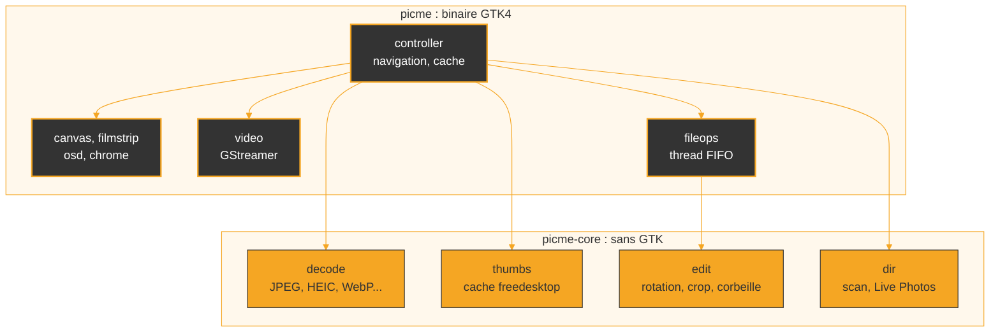

# picme

Une visionneuse d'images et de vidéos pour Linux. Elle s'ouvre vite, se pilote au clavier, et ne touche à tes fichiers que si tu le demandes. Rien d'autre.

```sh
picme photo.jpg          # le fichier, son dossier en liste de navigation
picme -r ~/Photos        # le premier média de tout l'arbre, et les flèches parcourent tout
```

- **Une seule chose.** Regarder. Pas de bibliothèque, pas d'import, pas d'index, pas de compte, pas de fichier de configuration, aucune dépendance réseau. Un chemin en argument, c'est tout.
- **Rapide.** Le décodage de la première image démarre avant l'init de GTK. Premier affichage d'un JPEG de 24 MP : environ 280 ms à froid (médiane mesurée avec `PICME_TRACE=1`, dont une centaine de ms d'init GTK). Le décodage ne bloque jamais l'interface, la touche maintenue défile sans à-coup, le cache de textures est borné (256 Mo).
- **Sans surprise sur tes fichiers.** Rotation JPEG sans recompression, PNG sans perte, écriture atomique. Suppr envoie à la corbeille, Ctrl+Z la reprend pendant 30 s. Aucun état caché : le seul cache est celui des miniatures freedesktop, partagé avec les autres programmes.
- **Se compose.** Un chemin ou un dossier en argument, `-r` pour l'arbre, un code de sortie honnête, des erreurs sur stderr. Il se lance depuis un shell, un script ou un gestionnaire de fichiers (`picme.desktop`).

Formats : JPEG, PNG, WebP, TIFF, HEIC et AVIF, JPEG XL, vidéos (MP4, MOV, MKV, WebM, AVI, 3GP), GIF, BMP, ICO, QOI, PNM, et les RAW avec la feature `raw`.

## Architecture



`picme-core` ne dépend pas de GTK : décodage, miniatures, scan de dossier et édition sans perte se testent seuls. Le binaire `picme` porte la fenêtre, le controller (navigation, pool de décodage, répétition clavier) et le thread FIFO qui exécute les opérations sur les fichiers l'une après l'autre.

## Usage

`picme <fichier>` ouvre le fichier et son dossier devient la liste de navigation, triée par nom. Le bandeau de miniatures (filmstrip) suit l'image courante.

`picme -r [dossier]` (`--recursive`) parcourt aussi les sous-dossiers : il ouvre aussitôt le premier média trouvé dans l'arborescence, et la liste de navigation est tout l'arbre, à plat (les médias d'un dossier, puis ceux de ses sous-dossiers dans l'ordre naturel ; dossiers et fichiers cachés ignorés, liens symboliques vers un dossier non suivis). Une Live Photo ne s'apparie qu'avec un `.mov` du même dossier. Le dossier lui-même n'est surveillé que au premier niveau : un fichier ajouté par un autre programme dans un sous-dossier n'apparaît qu'au prochain lancement ; les opérations de picme (rotation, recadrage, suppression) sont suivies partout. O ouvre le dossier de l'image affichée. Ouvrir un fichier d'un autre arbre (glisser-déposer) revient à la navigation d'un seul dossier.

- Une Live Photo (image HEIC ou JPEG avec le `.mov` du même nom) s'affiche comme une image avec un petit repère `LIVE` ; le `.mov` joue tant que L est tenue.
- Le `.mov` n'est apparié que si une seule image porte ce nom de base (IMG_0001.HEIC avec IMG_0001.jpg : pas d'appariement) et s'il pèse moins de 15 Mio ; sinon il reste une vidéo à part entière, avec sa propre entrée, et Suppr sur l'image ne touche pas à lui. Un apparié part à la corbeille avec son image.
- Une vidéo démarre à l'ouverture, sans son. M active le son ; si la sortie audio manque, le son se coupe de nouveau et un message le dit.
- Une touche tenue répète : Droite tenue fait défiler les images, Suppr tenue ne supprime qu'un fichier.

## Comparaison

Ce que picme fait et ne fait pas, face aux visionneuses courantes sous Linux. Relevé le 24/11/2026 dans les man pages, READMEs et sources de chaque projet ; « n.t. » veut dire que je n'ai rien trouvé qui le confirme, pas que la fonction n'existe pas. Une correction est la bienvenue.

| | picme | feh | nsxiv | imv | eog | Loupe | Gwenview | Geeqie |
|---|---|---|---|---|---|---|---|---|
| Toolkit | GTK4 | Imlib2 | Imlib2 | GL | GTK3 | GTK4 | Qt6 | GTK4 |
| Wayland natif | non (X11) | non | non | oui | oui | oui | oui | partiel |
| Vidéo intégrée | oui | non | non | non | non | non | oui | aperçu seul |
| HEIC, AVIF, JPEG XL | oui | selon Imlib2 | selon Imlib2 | oui (option) | loaders tiers | oui | plugins Qt | oui (option) |
| Rotation JPEG sans perte, écrite dans le fichier | oui | partiel (jpegtran) | non | non | oui | oui (tag EXIF) | oui | oui |
| Recadrage qui écrit le fichier | oui | non | non | non | non | oui | oui | copie seulement |
| Suppression vers la corbeille | oui | non | non | non | oui | oui | oui | oui |
| Annuler une suppression | oui (30 s) | non | non | non | non | oui | non | partiel |
| Navigation récursive | oui (`-r`) | oui | oui | oui | non | non | n.t. | partiel |
| Bandeau de miniatures | oui | non | non | non | oui | non | oui | n.t. |
| Cache de miniatures freedesktop | oui | partiel | non | non | oui | n.t. | oui | oui |
| GIF animé | oui, en boucle, Espace pause (décodé en mémoire : au-delà de 256 Mo ou 2000 frames, image fixe) | non | oui | oui | oui | oui | n.t. | oui |
| Diaporama | non | oui | oui | oui | oui | n.t. | oui | oui |
| Panneau EXIF | oui | partiel | partiel | non | oui | oui | oui | oui |
| Carte des coordonnées GPS | oui, carte de tout le dossier, dans le navigateur (page servie sur 127.0.0.1 le temps de la consultation) | n.t. | n.t. | n.t. | n.t. | n.t. | n.t. | n.t. |

Lecture honnête : picme est la seule de la liste à cumuler la lecture vidéo, la corbeille avec annulation et les opérations sans perte sur les fichiers, dans une fenêtre qui se pilote au clavier. En contrepartie, il n'a ni Wayland natif, ni diaporama, et ses GIF animés sont décodés en entier en mémoire : un GIF de plus de 256 Mo décodés ou de plus de 2000 frames reste une image fixe. Si tu cherches un outil minimal pour un window manager X11, feh et nsxiv font moins de choses et le font très bien ; si tu veux tout cela dans une application de bureau complète, regarde Gwenview.

## Raccourcis

| Touche | Action |
|---|---|
| Droite, Page suivante, Espace | image suivante (sur une vidéo ou un GIF animé, Espace est pause et reprise) |
| Gauche, Page précédente, Retour arrière | image précédente |
| Home, End | première, dernière image |
| F | bascule entre ajusté à la fenêtre et 100 % |
| +, - , 0 | zoom avant, arrière, ajusté |
| R, Maj+R | tourne le fichier de 90 degrés à droite, à gauche (JPEG sans recompression, PNG ré-encodé sans perte, autres formats : vue seule pour la session) |
| Ctrl+Droite, Ctrl+Gauche | tourne la vue seulement, le fichier ne change pas |
| C | recadrage interactif (voir plus bas) |
| Suppr | envoie l'image (et le `.mov` d'une Live Photo) à la corbeille |
| Maj+Suppr | supprime : l'image passe par la corbeille, qui en est vidée au bout de 30 s (ou en quittant) ; sur un filesystem sans corbeille, suppression immédiate |
| Ctrl+Z | remet à sa place le dernier fichier retiré par Suppr ou Maj+Suppr, dans les 30 s |
| Maj+Droite, Maj+Gauche | sur une vidéo, saute de 5 secondes |
| M | son de la vidéo (coupé par défaut) |
| L | tenue : joue la vidéo d'une Live Photo |
| F11 | plein écran |
| ?, F1 | aide : la liste des raccourcis par-dessus l'image, une touche la ferme |
| O | ouvre le dossier courant dans le gestionnaire de fichiers du système |
| I | informations de l'image par-dessus l'image, une touche les ferme : nom, taille, dimensions, date de prise de vue, appareil, objectif, focale, ouverture, temps de pose, ISO et position GPS, quand le fichier les porte |
| G | carte des photos géolocalisées du dossier (de tout l'arbre avec `-r`) : une page HTML que le navigateur par défaut ouvre, avec un marqueur par photo et l'image affichée au centre ; elle est servie en local sur 127.0.0.1 (port éphémère, rien d'écrit sur le disque) le temps de la consultation, pour que les tuiles OpenStreetMap acceptent la requête, et le serveur s'arrête 10 minutes après la dernière consultation ; Leaflet et les tuiles sont chargés par le navigateur, picme ne fait aucun appel réseau vers l'extérieur |
| Q, Échap | quitter (Échap annule d'abord un recadrage) |

À la souris : la molette change d'image, Ctrl+molette zoome autour du curseur, le double-clic bascule le zoom, le glisser déplace l'image quand elle dépasse la fenêtre.

## Recadrage

C pose un rectangle redimensionnable sur l'image affichée : ratio libre, huit poignées discrètes, un glisser à l'intérieur déplace le cadre. Entrée écrit une copie `<nom>-crop.<ext>` à côté de l'original et l'ouvre. Maj+Entrée remplace l'original par le recadrage et envoie l'ancien fichier à la corbeille. Échap annule sans rien écrire. Un JPEG est recadré sans recompression (origine alignée sur le bloc MCU), PNG et TIFF gardent leur format, tout le reste sort en JPEG qualité 92 et en copie seulement. Le recadrage est refusé tant que la vue est tournée par Ctrl+flèches, et sur une vidéo. Changer d'image ou de dossier le ferme.

## Glisser-déposer

Depuis picme : glisser l'image courante vers un file manager ou une autre application l'envoie en `text/uri-list` (fichier et `.mov` d'une Live Photo). La cible choisit la copie ou le déplacement ; si elle déplace, le fichier quitte la vue de picme et la Live Photo suit.

Conflit avec le déplacement de l'image : quand l'image est ajustée à la fenêtre, le glisser emporte le fichier. Quand elle dépasse la fenêtre (zoom), le glisser la déplace (pan) et **Maj+glisser** emporte le fichier. Le glisser depuis le filmstrip n'est pas pris en charge.

Vers picme : déposer un fichier sur la fenêtre l'ouvre et son dossier devient le dossier courant. picme n'ouvre que le fichier : il ne le déplace ni ne le supprime, et la source ne le perd que si elle le déplace elle-même. Un glisser parti de la même fenêtre est ignoré.

## Limites

- Un JPEG tronqué ou aux données corrompues s'affiche tel que libjpeg le lit (la partie manquante est grise) ; il n'est ni tourné ni recadré, aucune miniature n'en est écrite.
- Une image HEIC, AVIF ou JPEG XL de plus de 200 Mpx est refusée avant toute allocation, avec un message d'erreur qui le dit ; le recadrage avec ré-encodage applique le même plafond.
- Un PNG, TIFF ou WebP dont la taille décodée dépasse 512 Mio est refusé (limite de décodage de la crate `image`).

## Compilation

Rien ne se compile sur le poste : tout passe par le compose du projet (image Debian, `network_mode: none`, sauf le service `fetch`).

```
docker compose up -d
docker compose exec -T fetch cargo fetch
docker compose exec -T dev cargo build --release --offline
docker compose exec -T dev cargo test --workspace --offline
docker compose exec -T dev cargo clippy --workspace --all-targets --offline -- -D warnings
docker compose exec -T dev cargo build --release --offline --features raw
```

Le binaire est `target/release/picme`. La feature `raw` (rawler, désactivée par défaut) ajoute le décodage des RAW ; sans elle, ces fichiers ne s'affichent pas.

Le cookie Xauthority est lié au hostname : le service `dev` prend celui du poste (`fixe-sam` par défaut). Sur un autre poste, `PICME_HOST=laptop-sam docker compose up -d` recrée le container avec le bon nom. Pour une capture sans toucher à l'écran, `DISPLAY=:99` sur un Xvfb : `docker compose exec -T -e DISPLAY=:99 dev ...`.

## Installation

Le binaire est construit sous Debian et exécuté sous Manjaro : les sonames doivent correspondre.

```
install -Dm755 target/release/picme ~/.local/bin/picme
install -Dm644 picme.desktop ~/.local/share/applications/picme.desktop
update-desktop-database ~/.local/share/applications
ldd ~/.local/bin/picme | grep "not found"
```

`ldd` ne doit rien afficher. À l'exécution il faut sur le poste GTK4, libheif avec ses plugins de codec (sinon « unsupported codec »), GStreamer avec `gst-libav` ou `gst-plugin-va` pour les `.MOV` HEVC d'iPhone. `picme.desktop` déclare tous les types de fichiers pris en charge : `xdg-mime default picme.desktop image/jpeg` en fait la visionneuse par défaut. `PICME_TRACE=1 picme <fichier>` affiche les temps jusqu'au premier affichage.
