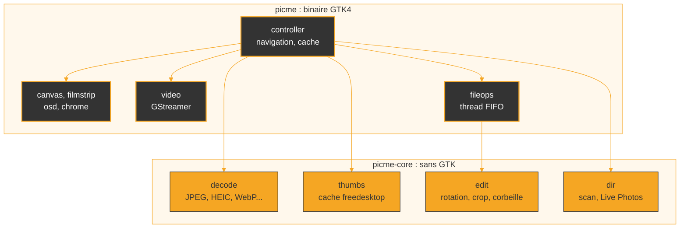

# picme

Visionneuse d'images et de vidéos pour Linux (GTK4), pensée pour la vitesse : premier affichage en moins de 250 ms, navigation au clavier, opérations sans perte sur les fichiers. Formats : JPEG, PNG, WebP, TIFF, HEIC et AVIF, JPEG XL, vidéos (MP4, MOV, MKV, WebM, AVI, 3GP), et les RAW avec la feature `raw`.

## Architecture



`picme-core` ne dépend pas de GTK : décodage, miniatures, scan de dossier et édition sans perte se testent seuls. Le binaire `picme` porte la fenêtre, le controller (navigation, pool de décodage, répétition clavier) et le thread FIFO qui exécute les opérations sur les fichiers l'une après l'autre.

## Usage

`picme <fichier>` ouvre le fichier et son dossier devient la liste de navigation, triée par nom. Le bandeau de miniatures (filmstrip) suit l'image courante.

- Une Live Photo (image HEIC ou JPEG avec le `.mov` du même nom) s'affiche comme une image avec un petit repère `LIVE` ; le `.mov` joue tant que L est tenue.
- Une vidéo démarre à l'ouverture, sans son. M active le son ; si la sortie audio manque, le son se coupe de nouveau et un message le dit.
- Une touche tenue répète : Droite tenue fait défiler les images, Suppr tenue ne supprime qu'un fichier.

## Raccourcis

| Touche | Action |
|---|---|
| Droite, Page suivante, Espace | image suivante (sur une vidéo, Espace est pause et reprise) |
| Gauche, Page précédente, Retour arrière | image précédente |
| Home, End | première, dernière image |
| F | bascule entre ajusté à la fenêtre et 100 % |
| +, - , 0 | zoom avant, arrière, ajusté |
| R, Maj+R | tourne le fichier de 90 degrés à droite, à gauche (JPEG sans recompression, PNG ré-encodé sans perte, autres formats : vue seule pour la session) |
| Ctrl+Droite, Ctrl+Gauche | tourne la vue seulement, le fichier ne change pas |
| C | recadrage interactif (voir plus bas) |
| Suppr | envoie l'image (et le `.mov` d'une Live Photo) à la corbeille |
| Maj+Suppr | supprime définitivement |
| Maj+Droite, Maj+Gauche | sur une vidéo, saute de 5 secondes |
| M | son de la vidéo (coupé par défaut) |
| L | tenue : joue la vidéo d'une Live Photo |
| F11 | plein écran |
| Q, Échap | quitter (Échap annule d'abord un recadrage) |

À la souris : la molette change d'image, Ctrl+molette zoome autour du curseur, le double-clic bascule le zoom, le glisser déplace l'image quand elle dépasse la fenêtre.

## Recadrage

C pose un rectangle redimensionnable sur l'image affichée : ratio libre, huit poignées discrètes, un glisser à l'intérieur déplace le cadre. Entrée écrit une copie `<nom>-crop.<ext>` à côté de l'original et l'ouvre. Maj+Entrée remplace l'original par le recadrage et envoie l'ancien fichier à la corbeille. Échap annule sans rien écrire. Un JPEG est recadré sans recompression (origine alignée sur le bloc MCU), PNG et TIFF gardent leur format, tout le reste sort en JPEG qualité 92 et en copie seulement. Le recadrage est refusé tant que la vue est tournée par Ctrl+flèches, et sur une vidéo. Changer d'image ou de dossier le ferme.

## Glisser-déposer

Depuis picme : glisser l'image courante vers un file manager ou une autre application l'envoie en `text/uri-list` (fichier et `.mov` d'une Live Photo). La cible choisit la copie ou le déplacement ; si elle déplace, le fichier quitte la vue de picme et la Live Photo suit.

Conflit avec le déplacement de l'image : quand l'image est ajustée à la fenêtre, le glisser emporte le fichier. Quand elle dépasse la fenêtre (zoom), le glisser la déplace (pan) et **Maj+glisser** emporte le fichier. Le glisser depuis le filmstrip n'est pas pris en charge.

Vers picme : déposer un fichier sur la fenêtre l'ouvre et son dossier devient le dossier courant. picme n'ouvre que le fichier : il ne le déplace ni ne le supprime, et la source ne le perd que si elle le déplace elle-même. Un glisser parti de la même fenêtre est ignoré.

## Compilation

Rien ne se compile sur le poste : tout passe par le compose du projet (image Debian, `network_mode: none`, sauf le service `fetch`).

```
docker compose up -d
docker compose exec -T fetch cargo fetch
docker compose exec -T dev cargo build --release --offline
docker compose exec -T dev cargo test --workspace --offline
docker compose exec -T dev cargo clippy --workspace --all-targets --offline -- -D warnings
docker compose exec -T dev cargo build --release --offline --features raw
```

Le binaire est `target/release/picme`. La feature `raw` (rawler, désactivée par défaut) ajoute le décodage des RAW ; sans elle, ces fichiers ne s'affichent pas.

Le cookie Xauthority est lié au hostname : le service `dev` prend celui du poste (`fixe-sam` par défaut). Sur un autre poste, `PICME_HOST=laptop-sam docker compose up -d` recrée le container avec le bon nom. Pour une capture sans toucher à l'écran, `DISPLAY=:99` sur un Xvfb : `docker compose exec -T -e DISPLAY=:99 dev ...`.

## Installation

Le binaire est construit sous Debian et exécuté sous Manjaro : les sonames doivent correspondre.

```
install -Dm755 target/release/picme ~/.local/bin/picme
install -Dm644 picme.desktop ~/.local/share/applications/picme.desktop
update-desktop-database ~/.local/share/applications
ldd ~/.local/bin/picme | grep "not found"
```

`ldd` ne doit rien afficher. À l'exécution il faut sur le poste GTK4, libheif avec ses plugins de codec (sinon « unsupported codec »), GStreamer avec `gst-libav` ou `gst-plugin-va` pour les `.MOV` HEVC d'iPhone. `picme.desktop` déclare tous les types de fichiers pris en charge : `xdg-mime default picme.desktop image/jpeg` en fait la visionneuse par défaut. `PICME_TRACE=1 picme <fichier>` affiche les temps jusqu'au premier affichage.
